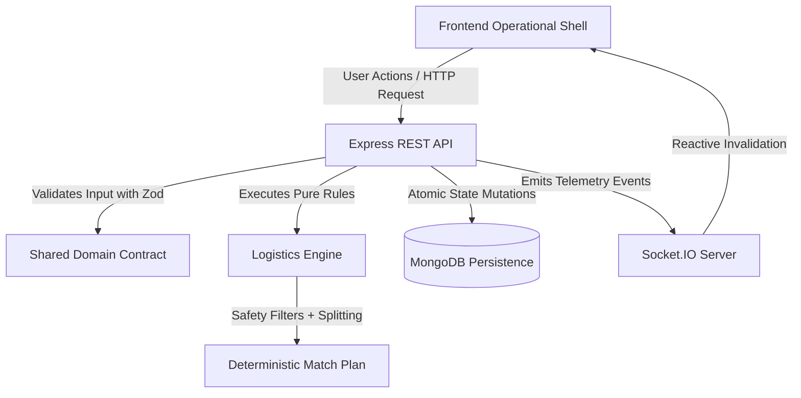
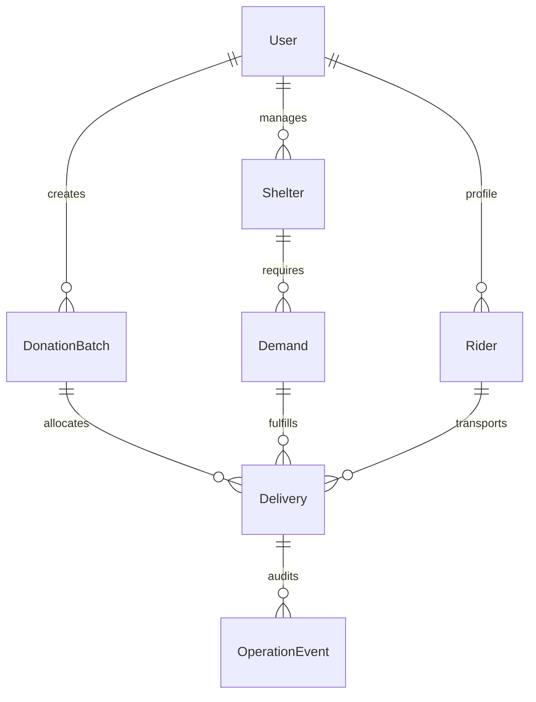
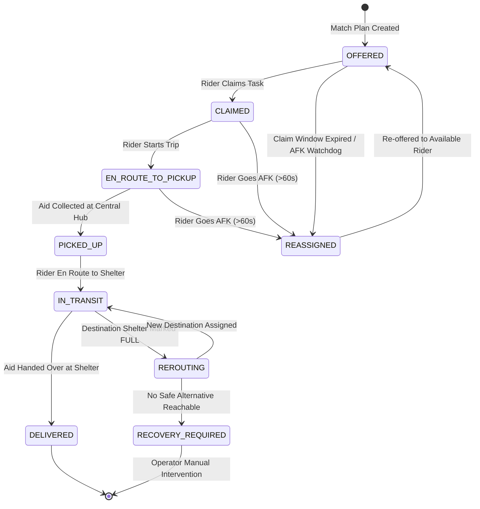
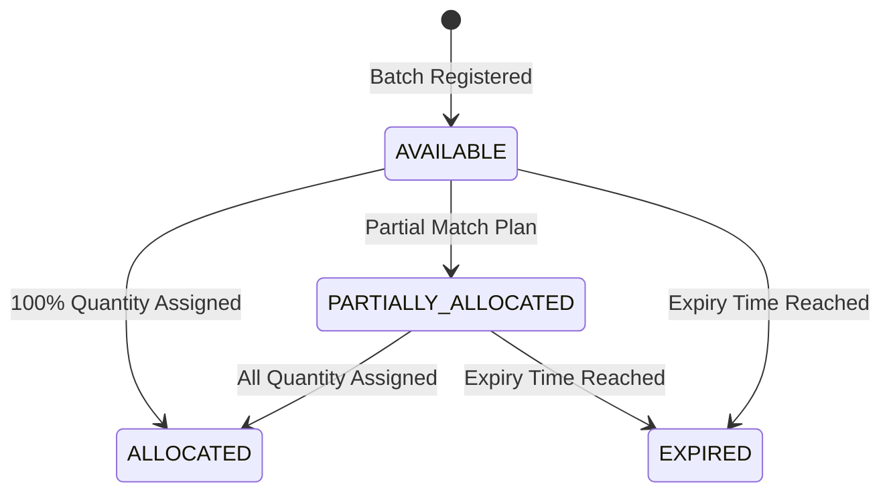
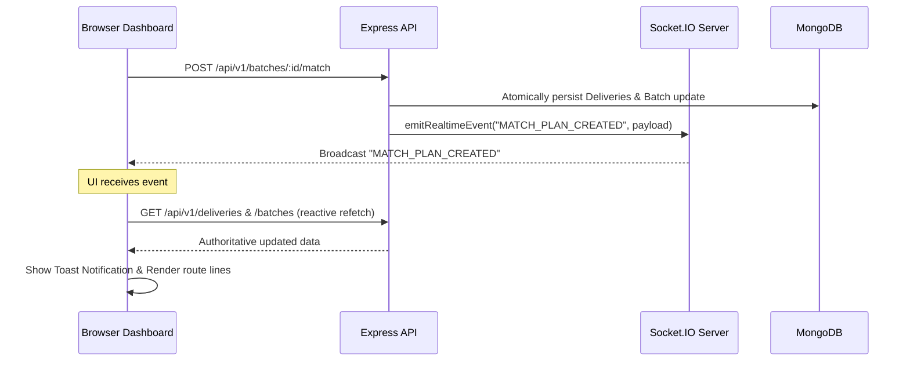

# CivicAid Dispatch — System Architecture & Mechanics

This document provides a comprehensive technical breakdown of CivicAid Dispatch's domain modeling, logistics engine algorithms, state machines, and real-time communication topology.

---

## 1. Architectural Foundations

### 1.1 The Backend Authority Principle
All critical decisions regarding aid safety, spoilage risk, vehicle capacity limits, state transitions, and delivery reroutes are **strictly enforced on the backend**. The frontend acts exclusively as a reactive operational shell and visualization layer. It never computes or decides whether a delivery is safe to dispatch.



### 1.2 Monorepo Workspaces Layout
The project is organized into an npm workspaces monorepo:

| Package | Path | Purpose |
|---|---|---|
| `@civicaid/shared` | `packages/shared` | Authoritative domain types, Zod schemas, enums, Socket events, and pure logistics algorithms. Free of HTTP, browser, or database dependencies. |
| `api` | `apps/api` | Node.js Express 5 REST API with MongoDB persistence, background watchdog worker, and Socket.IO real-time server. |
| `web` | `apps/web` | React 19 + TypeScript + Vite SPA featuring interactive Leaflet dispatch maps, KPI telemetry, and simulation controls. |

---

## 2. Domain Data Model & Persistence

The platform persists operational entities in MongoDB with geospatial `2dsphere` indexes.



### 2.1 Core Entities & Important Fields

#### `DonationBatch`
- `donorId`: Reference to `User` (Donor).
- `aidType`: Enum (`COOKED_MEALS`, `RAW_RATION`, `MEDICINE`, `INFANT_FORMULA`, `ESSENTIAL_KIT`).
- `quantity`: Total donated units.
- `remainingQuantity`: Units still unallocated to active deliveries.
- `pickupLocation`: GeoJSON `Point` (`[longitude, latitude]`).
- `expiresAt`: Absolute timestamp when aid becomes unsafe or spoiled.
- `handling`: Facility requirements:
  - `requiresCleanWater: boolean`
  - `requiresCookingFuel: boolean`
  - `requiresRefrigeration: boolean`
- `status`: `AVAILABLE` | `PARTIALLY_ALLOCATED` | `ALLOCATED` | `EXPIRED`.

#### `Rider`
- `userId`: Reference to `User` (Rider).
- `status`: `AVAILABLE` | `RESERVED` | `BUSY` | `AFK`.
- `vehicleCapacity`: Maximum units the rider can transport (default: 40 meals).
- `currentLocation`: GeoJSON `Point` (indexed with `2dsphere`).
- `lastHeartbeatAt`: Timestamp of last telemetry ping from rider device.
- `activeDeliveryId`: Reference to currently active `Delivery`.

#### `Shelter`
- `name`: Human-readable identifier (e.g. Shelter Alpha).
- `status`: `OPEN` | `FULL` | `CLOSED`.
- `location`: GeoJSON `Point` (indexed with `2dsphere`).
- `capacity`: Maximum occupancy capacity.
- `currentOccupancy`: Current active occupants.
- `facilities`: Facility capabilities:
  - `cleanWater: boolean`
  - `cookingFuel: boolean`
  - `refrigeration: boolean`
- `acceptedAidTypes`: Array of allowed `AidType` values.

#### `Demand`
- `shelterId`: Reference to destination `Shelter`.
- `aidType`: Type of aid requested.
- `requestedQuantity`: Total units needed.
- `fulfilledQuantity`: Total units currently allocated or delivered.
- `urgency`: Priority ranking (`LOW`, `MEDIUM`, `HIGH`, `CRITICAL`).
- `status`: `OPEN` | `PARTIALLY_FULFILLED` | `FULFILLED`.

#### `Delivery`
- `batchId`: Source donation batch.
- `demandId`: Target shelter demand.
- `riderId`: Assigned rider.
- `quantity`: Allocated portion.
- `status`: Delivery lifecycle state (see state machine below).
- `pickupLocation`: Origin coordinates.
- `destinationLocation`: Current destination coordinates.
- `estimatedMinutes`: Estimated travel time.
- `claimExpiresAt`: Deadline for rider to claim an offered task (e.g. 180s).
- `lastHeartbeatAt`: Rider's last heartbeat for this specific delivery.
- `rerouteCount`: Counter of mid-transit diversions.
- `failureReason`: Recorded explanation if delivery fails or requires recovery.

#### `OperationEvent`
- Append-only audit trail logging every automated match, claim, heartbeat timeout, reroute, and operator override with `type`, `severity`, `message`, and structured `metadata`.

---

## 3. Lifecycle State Machines

### 3.1 Delivery Task State Machine
Legal state transitions are strictly governed by `canTransitionDelivery(from, to)`:



### 3.2 Donation Batch Lifecycle


---

## 4. Pure Logistics Engine Algorithms

The logistics engine in [`packages/shared/src/logistics.ts`](file:///d:/J1-Backup/packages/shared/src/logistics.ts) is implemented as pure, deterministic functions without side effects.

### 4.1 Safe Arrival Equation
A delivery is considered safe if and only if the aid arrives at the shelter with at least a mandatory safety buffer (default: 5 minutes) before the batch expires:

$$\text{Estimated Arrival} = t_{\text{now}} + t_{\text{travel}} + t_{\text{safetyBuffer}}$$
$$\text{Is Safe} \iff \text{Estimated Arrival} < t_{\text{expiresAt}}$$

If the inequality fails, the candidate shelter is rejected immediately, preventing riders from transporting soon-to-be-spoiled food.

### 4.2 Facility Compatibility Rules
Perishable and fragile aid types require strict infrastructure compatibility:

$$\text{isCompatible} = \begin{cases}
\text{shelter.cleanWater} \land \text{shelter.cookingFuel}, & \text{if } \text{aidType} = \text{RAW\_RATION} \\
\text{shelter.refrigeration}, & \text{if } \text{requiresRefrigeration} = \text{true} \\
\text{shelter.status} = \text{OPEN}, & \text{always} \\
\text{aidType} \in \text{shelter.acceptedAidTypes}, & \text{always}
\end{cases}$$

### 4.3 Multi-Rider Capacity Splitting Algorithm
Given a donation batch with remaining quantity $Q_{\text{batch}}$, shelter demands $D_i$ with remaining needs $Q_{D_i}$, and available riders $R_j$ with capacity $C_{R_j}$:

$$\text{Allocation Quantity} = \min(Q_{\text{batchRem}}, Q_{D_i\text{Rem}}, C_{R_j})$$

#### Step-by-Step Execution:
1. Filter all candidate shelters and riders against hard safety and availability constraints.
2. Rank eligible shelters by urgency and proximity:
   $$\text{Score}_{\text{shelter}} = w_{\text{urgency}} \cdot \text{Urgency} - w_{\text{dist}} \cdot \text{Distance}(\text{Pickup}, \text{Shelter})$$
3. Rank eligible riders by proximity to the pickup point:
   $$\text{Score}_{\text{rider}} = - \text{Distance}(\text{Rider}, \text{Pickup})$$
4. Loop greedily:
   - Match the highest-ranked shelter with remaining unmet demand.
   - Match the closest available rider.
   - Allocate $\min(Q_{\text{batch}}, Q_{\text{demand}}, C_{\text{rider}})$.
   - Decrement $Q_{\text{batch}}$, decrement $Q_{\text{demand}}$, and mark the rider as `RESERVED`.
5. Repeat until $Q_{\text{batch}} = 0$, all demands are fulfilled, or no eligible riders remain.
6. Any unallocated portion is recorded with explicit rejection reasons.

### 4.4 Mid-Transit Dynamic Rerouting
When a shelter status changes to `FULL` or `CLOSED`:
1. Query all active deliveries currently en route to that shelter (`CLAIMED`, `EN_ROUTE_TO_PICKUP`, `PICKED_UP`, `IN_TRANSIT`).
2. For each delivery:
   - Identify candidate alternative shelters that are `OPEN`, have compatible facilities for the batch, have open demand for that aid type, and have remaining physical occupancy capacity.
   - Calculate revised travel time from the rider's current coordinates to the candidate shelter:
     $$t_{\text{reroute}} = t_{\text{travel}}(\text{RiderLocation}, \text{NewShelter})$$
   - Verify safe arrival: $t_{\text{now}} + t_{\text{reroute}} + t_{\text{buffer}} < t_{\text{batchExpiry}}$.
   - If a valid alternative exists:
     - Divert destination coordinates to the new shelter.
     - Increment `rerouteCount`.
     - Update ETA and notify the rider.
     - Emit `DELIVERY_REROUTED`.
   - If no valid alternative exists:
     - Transition delivery status to `RECOVERY_REQUIRED`.
     - Record failure reason: `"No reachable shelter with compatible facilities and capacity"`.
     - Emit `RECOVERY_REQUIRED` with `CRITICAL` severity for human dispatcher intervention.

### 4.5 Silent Rider Heartbeat Watchdog
Riders periodically submit location pings (`lastHeartbeatAt`).
The automated watchdog runs every 5 seconds:
$$\text{Is Stale} \iff t_{\text{now}} - t_{\text{lastHeartbeatAt}} > \text{TIMEOUT} \quad (\text{default: } 60\text{ seconds})$$

When staleness is detected:
1. The rider is updated to `AFK`.
2. Any active delivery in `OFFERED`, `CLAIMED`, or `EN_ROUTE_TO_PICKUP` is revoked:
   - The delivery is set to `OFFERED`.
   - The active delivery reference on the rider is cleared.
   - The task is immediately made available to other active riders.
3. An audit event `RIDER_DECLARED_AFK` is broadcast over Socket.IO.

---

## 5. Real-Time WebSocket Architecture

CivicAid Dispatch utilizes **Socket.IO** configured with a reactive invalidation pattern:



### 5.1 Rooms Structure
- `operations`: Global dispatch room for system-wide alerts, KPI updates, and event logs.
- `shelter:<id>`: Scoped room for shelter occupancy and demand alerts.
- `rider:<id>`: Scoped room for assignments, route changes, and heartbeat acknowledgments.
- `batch:<id>`: Scoped room for allocation progress on specific donation batches.

---

## 6. Geospatial Map Architecture

The frontend map component ([`DispatchMap.tsx`](file:///d:/J1-Backup/apps/web/src/components/DispatchMap.tsx)) is built with Leaflet and configured with multiple zero-cost, reliable tile providers:

```
DispatchMap
├── MapContainer (Ref-based Leaflet Canvas, centered on Delhi [28.6328, 77.2195])
│   ├── TileLayerGroup (Dynamic style switcher)
│   │   ├── 🌙 Dark: Esri World Dark Gray Canvas + Reference Labels
│   │   ├── 🗺️ Streets: OpenStreetMap standard tiles
│   │   └── 🛰️ Satellite: Esri World Imagery + Boundaries
│   │
│   └── MarkerLayerGroup (Auto-bounds recalculation)
│       ├── Pickup Hub Pin (📦 Blue circle with radial glow)
│       ├── Shelter Pins (🏠 Green=Open, Red=Full, Grey=Closed)
│       ├── Rider Pins (🏍️ Green=Available, Purple=Busy, Red=AFK)
│       └── Delivery Polylines (Dashed glowing routes, Amber for rerouted)
```
